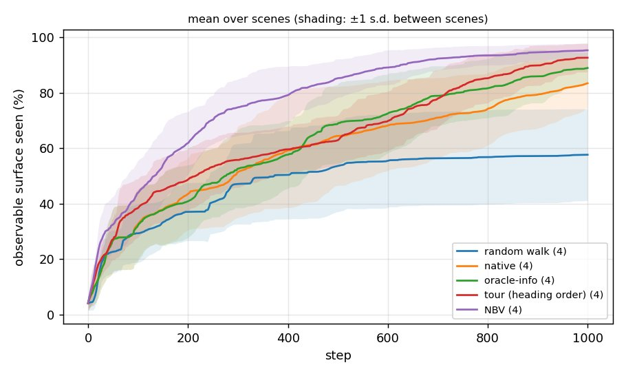
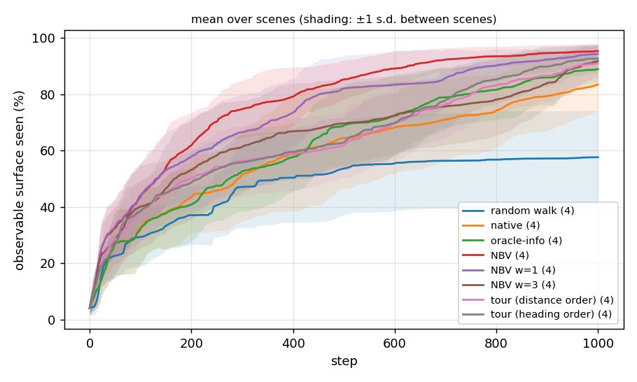
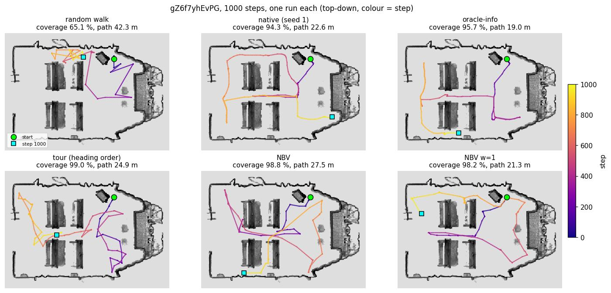

# Oracle (prior-informed) baselines: how much does knowing the scene help?

Date of the runs: 2026-10-12 to 2026-10-14 (log written 2026-10-29 from the archived runs and `docs/oracle_baselines.md` / `docs/oracle_results.md`; nothing was rerun).

## Question
Only the *viewpoint selection* is changed; the SplaTAM mapper stays online and never sees the ground-truth (GT) geometry. So any change in coverage, image quality or path length is the value of prior knowledge about the scene. How far above ActiveSplat's native planner can oracle planners get, and does more coverage give better maps?

## Setup
- Scenes (Matterport3D, `config/datasets/mp3d_high_resolution*.json`, 512² sensor, 10 mapping iterations): gZ6f7yhEvPG, GdvgFV5R1Z5, pLe4wQe7qrG, YmJkqBEsHnH. 1000 steps each, equal budget for every method.
- Methods (one label per run in `<run>/label.txt`):
  - **random walk**: `scripts/oracle/random_walk.py` (seed fixed), replayed. Lower bound.
  - **native**: ActiveSplat's planner. Repeated with `ACTIVESPLAT_SEED` (3 runs per scene, 2 on pLe4wQe7qrG) to measure run-to-run noise.
  - **oracle-info** (Tier 2): `planner.oracle.mode = info`. The mapper's look-around invisibility (opacity + depth) is replaced by GT-mesh raycasts against the set of already-observed surface voxels (5 cm). Same candidates, travel cost and rotation selection as native; only "what is still unseen" is known.
  - **tour** (budgeted offline tour, `scripts/oracle/plan_tour.py --max_steps 1000`): greedy set cover over candidate views (grid x yaw x pitch -30/0/30) on the GT navmesh, greedy insertion by new surface per added action, 2-opt, converted to discrete actions and replayed (`mode:=REPLAY`). Two orderings: distance order (`--no_heading_order`) and heading-aware.
  - **NBV** (Tier 3, `scripts/oracle/plan_nbv.py --max_steps 1000`): closed-loop greedy next-best-view with free candidate poses on the GT navmesh, replayed. `NBV w=1` / `w=3`: `--view_weight`, a second sighting from a direction at least 20° from the first is worth w new samples.
- Coverage (`scripts/oracle/coverage.py`, `src/oracle/`): share of the *observable* GT surface seen by the sensor (reachable from the start floor's navmesh island, within the 4 m mapper range and tilt limits), per step. "two directions" = share seen from two directions at least 20° apart. AUC = mean of the coverage curve over 1000 steps. Image metrics (`src/evaluation/image_eval.py`): PSNR / SSIM / LPIPS on trajectory views, and on 100 held-out "novel" views within 1.5 m of the trajectory.
- Launch pattern per scene (see `docs/oracle_baselines.md` for the design): `python scripts/oracle/precompute_observable.py --config <cfg> --user_config config/user_config.json --scene_id <scene>`, then `plan_tour.py` / `plan_nbv.py` / `random_walk.py` write an `actions.txt`, which is replayed through the normal launch (`mode:=REPLAY`); native and oracle-info are normal launches with the respective config. The exact roslaunch lines were not recorded at the time: **not reconstructible from the run directories**, only config, actions and labels are.
- Comparison: `python scripts/oracle/compare.py --results_dir results/archive --steps 1000 --out docs/oracle_results.md --plots_dir docs/oracle_plots`. The runs live in `results/archive/` (`MANIFEST.txt`).
- Metadata of every run (git commit, config, optimisations, image metrics): appendix below and `runs.json`, produced by `scripts/tools/experiment_log.py`. Runs are named `<method>_<scene prefix>_<MM-DD_HH-MM>`. All 39 runs predate the optimisation switches and the span tracer ("baseline" code), run on the shared GPUs (how many concurrently was not recorded). The git commit in the metadata is the one *at log time*, not the one the runs were made with (use the dates: code of 2026-10-12 to 14, commits `62f3ab3` to `9f6a67a`).

## Results (1000 steps, mean over the four scenes)

± is the spread between scenes, not noise. "steps to 80 %" averages only the scenes that reach it.

| method | cov@100 | cov@300 | cov@500 | cov@1000 | AUC | steps to 80 % | path (m) | two directions % | PSNR | novel PSNR | novel SSIM | novel LPIPS |
|---|---|---|---|---|---|---|---|---|---|---|---|---|
| random walk | 29.3 | 47.1 | 53.6 | 57.6 | 47.7 | – | 42.3 | 39.4 | 21.3 | 21.5 | 0.762 | 0.263 |
| native | 32.6 | 51.4 | 64.4 | 83.4 | 59.0 | 625 ± 227 | 21.8 | 58.5 | 21.0 | 19.9 | 0.705 | 0.303 |
| oracle-info | 32.2 | 52.6 | 68.9 | 88.9 | 62.3 | 695 ± 190 | 22.6 | 63.1 | 21.8 | 20.6 | 0.718 | 0.302 |
| tour (distance order) | 38.1 | 56.3 | 62.0 | 90.8 | 63.6 | 744 ± 166 | 14.8 | 68.8 | 22.0 | 21.3 | 0.724 | 0.304 |
| tour (heading order) | 38.4 | 55.7 | 62.9 | 92.6 | 64.5 | 720 ± 121 | 22.2 | 70.2 | 21.4 | 20.6 | 0.705 | 0.320 |
| NBV | 44.0 | 74.7 | 85.2 | 95.3 | 77.2 | 395 ± 134 | 29.4 | 74.2 | 19.9 | 19.4 | 0.668 | 0.346 |
| NBV w=1 | 43.4 | 66.5 | 82.0 | 94.2 | 73.3 | 469 ± 187 | 24.3 | 79.0 | 20.6 | 19.9 | 0.692 | 0.331 |
| NBV w=3 | 40.1 | 61.3 | 69.6 | 91.7 | 65.5 | 678 ± 279 | 26.2 | 76.7 | 21.2 | 20.7 | 0.699 | 0.334 |



Shading is ±1 s.d. **between the four scenes**, so it is mostly scene difficulty (pLe4wQe7qrG and YmJkqBEsHnH are hard for every method), not noise of a method; the bands of different methods overlap for that reason even where the ranking is the same on every scene (it is for NBV vs the rest at AUC). The per-scene plots (`coverage_<scene>.jpg`) shade min to max over repeated runs, which exists only for native (2 to 3 seeds): that band is the run-to-run noise to compare the other single-run lines against. All eight methods: `coverage_all_scenes.jpg`.



Per scene (coverage at 1000 steps / AUC; native = mean of 2 to 3 seeds ± s.d., the others single runs):

| method | gZ6f7yhEvPG | GdvgFV5R1Z5 | pLe4wQe7qrG | YmJkqBEsHnH |
|---|---|---|---|---|
| random walk | 65.1 / 51.7 | 78.5 / 67.5 | 33.4 / 28.3 | 53.5 / 43.1 |
| native | 92.4 ± 1.7 / 71.5 ± 0.9 | 89.0 ± 2.7 / 72.8 ± 0.7 | 82.9 ± 0.3 / 45.2 ± 0.4 | 69.4 ± 6.2 / 46.6 ± 0.4 |
| oracle-info | 95.7 / 71.2 | 92.9 / 74.0 | 85.4 / 54.4 | 81.7 / 49.7 |
| tour (distance) | 98.2 / 75.0 | 94.5 / 71.3 | 90.0 / 58.8 | 80.7 / 49.1 |
| tour (heading) | 99.0 / 71.9 | 95.2 / 73.4 | 91.1 / 59.9 | 85.1 / 52.8 |
| NBV | 98.8 / 84.2 | 96.6 / 83.7 | 92.7 / 71.2 | 93.0 / 70.0 |
| NBV w=1 | 98.2 / 83.8 | 96.5 / 80.8 | 89.3 / 66.3 | 93.1 / 62.4 |
| NBV w=3 | 97.6 / 81.9 | 95.5 / 74.0 | 90.8 / 52.7 | 83.1 / 53.3 |

Per-scene curves: `coverage_<scene>.jpg`. Full per-scene tables (all columns incl. SSIM/LPIPS, steps to 80/90 %): `docs/oracle_results.md`.

Trajectory image quality per scene (PSNR, native = seed mean): gZ6f7yhEvPG 17.6 native / 17.8 oracle-info / 17.7 tour / 17.1 NBV; GdvgFV5R1Z5 24.5 / 24.2 / 24.7 / 23.6; pLe4wQe7qrG 26.1 / 25.6 / 25.1 / 24.9; YmJkqBEsHnH 15.7 / 19.7 / 20.7 / 14.1.

## How oracle-info, the tour and NBV differ

All three get the same GT mesh and are scored the same way; they differ in **what they use the GT for**, **where they may go**, and **whether they react while driving**.

| | oracle-info (Tier 2) | tour | NBV (Tier 3) |
|---|---|---|---|
| What is replaced by GT | Only the answer to "what is still unseen from this node?": the mapper's rendered look-around opacity/depth is swapped for GT-mesh raycasts against the observed-voxel set | Everything: surface to cover, navigable space, and the order of visits | Surface still unseen, navigable space; the choice of the next view |
| Candidate places | The native planner's own: Voronoi-graph nodes of the top-down free map **built online from the Gaussians**, so only places the mapper already knows to be free | Precomputed grid of positions x yaws x pitches (-30/0/30°) on the GT navmesh, including places not yet mapped | The same kind of free candidate poses on the GT navmesh, re-scored from the current pose |
| How a target is chosen | Native machinery: invisibility score per node, hierarchical subregion planner, rotation selection by largest unmapped cluster | Once, offline: greedy set cover (fewest views that see the surface), insertion by new surface per added action under the 1000-step budget, 2-opt on the route; the order is fixed in advance | Every time: the view with the highest (new surface, capped at what the remaining budget can reach) / (walking + turns + tilts); myopic greedy |
| Feedback | Closed loop on the **mapper's** state: re-plans each step from the growing map | **None** (open loop): writes `actions.txt`, replayed blindly; it never reacts to what the sensor or mapper actually got | Closed loop on the **oracle's** observed set while planning (replans from where it is), then the finished actions are replayed; it does not use the mapper either |
| Travel | Native: can only go where the map is known | Geodesic nearest-neighbour + 2-opt (distance order) or heading-aware (fewer turns) | Greedy geodesic follower to each chosen view |
| Cost to run | A 360° look-around raycast per node (10 to 40 ms), inside the run | About 15 s offline per scene | About 15 s offline per scene for 1000 steps |

In one sentence each:
- **oracle-info** is the native planner with perfect eyes: it knows exactly which surface is unseen, but it still has to discover the free space itself and picks among the nodes the mapper has built, so frontier-limited behaviour remains.
- **tour** is a global plan with perfect knowledge but no replanning: efficient in path length (14.8 m) and good at the end of the budget, but it visits places in route order, so early coverage is not prioritised (curves cross native's), and it cannot recover if execution drifts from the plan.
- **NBV** is a local, greedy plan with perfect knowledge and perfect replanning: it always takes the best next gain per action, which front-loads coverage (80 % in about 400 steps), at the price of more walking (29.4 m) and no global route optimality.

What the results say about the contrast (single runs apart from native, so indicative):
- oracle-info → NBV isolates the value of **knowing the free space and choosing free poses** (not just knowing what is unseen): AUC 62 to 77, 89 % to 95 % final coverage. oracle-info is within native noise on two scenes, so the unseen-geometry knowledge alone is a small part of the gain.
- tour → NBV isolates **replanning against greedy gain per action versus a fixed global route**: the tour matches NBV only at the end (92.6 % vs 95.3 % at 1000 steps) while AUC is 64.5 vs 77.2.
- oracle-info vs tour: the tour has a shorter path (14.8 m against 22.6 m), better final coverage (90.8 to 92.6 % against 88.9 %) and slightly better AUC (63.6 to 64.5 against 62.3); the oracle-info advantage is that it keeps the real mapper in the loop. Differences of this size are within what single runs can show. Not separated by this data: the two differ in several ways at once (candidates, route optimisation, feedback), and there is one run per scene.
- Caveat: these are three bundles of differences, not single-factor ablations. A cleaner test (e.g. oracle-info with GT navigation, or NBV restricted to mapper-known free space) was not run (`planner.oracle.navigation: gt_navmesh` is still open in `docs/oracle_baselines.md`).

## Pseudocode of each method

Simplified from `scripts/nodes/planner_node.py` (native, oracle-info) and `scripts/oracle/*.py` (the rest). Names are descriptive, not the code's. `act(a)` = one simulator action: forward 0.065 m, turn 10°, tilt 15°; every step the SplaTAM mapper maps the new frame.

### Random walk (`random_walk.py`; needs no scene, no mapper feedback)
```
actions = []
while len(actions) < 1000:
    turn = random choice of {LEFT, RIGHT}
    actions += [turn] * randint(0, 18)
    actions += [FORWARD] * randint(5, 30)          # blocked steps do nothing in the simulator
    if rand() < 0.03: actions.append(random choice of {UP, DOWN})
write actions[:1000]; replay them through ActiveSplat
```

### Native ActiveSplat planner (online, uses only the map built so far)
```
loop each planning step:
    free_map, visible_map = top-down render of the Gaussians          # what the mapper believes is free / seen
    graph = Voronoi graph of free_map; nodes = graph nodes; subregions = clusters of nodes
    for node in nodes (skip failed nodes, nodes near obstacles, nodes near already-rotated-at places):
        invisibility[node] = sum(1 - opacity) of a 360° look-around (3 renders) rendered from the Gaussians at node
    score[node] = weighted sum of: unvisited, not-failed, directly reachable by a line in free space,
                  inside the horizon box of the last forward move, normalised invisibility, normalised hole volume
    if hierarchical planning:
        if current subregion still has a node with invisibility above threshold (250): candidates = nodes of this subregion   # local plan
        else: candidates = nodes of the best-scoring other subregion                                                       # global plan
    for s in scores from high to low:                                      # ties: closest node by safe Dijkstra path on the graph
        pick the node with score s that has a path; skip nodes that are too far if a nearer one is acceptable
    follow the path (interpolated waypoints) to the node
    on arrival: choose the look-direction (rotation, pitch) toward the largest unmapped cluster in the local look-around,
                rotate there, map, repeat
if everything is visited or failed: relax weights (invisibility 10, ignore horizon) and clear the failed list
```

### Oracle-info (Tier 2) = the native loop with one change
```
same as native, except the look-around is not rendered from the Gaussians:
    invisibility[node] = number of GT-mesh surface samples visible in the 360° look-around from node (raycast, 4 m range)
                         that the sensor has NOT yet observed      # observed set = voxels (5 cm) updated from every received frame
candidate nodes, scoring, hierarchy, travel and rotation selection are untouched;
nodes still come from the Voronoi graph of the mapper's own free map
```

### Tour (offline, open loop; `plan_tour.py --max_steps 1000`)
```
views     = {(position, yaw, pitch)}: GT-navmesh positions x yaws x pitches (-30, 0, 30°)
visible[v]= GT observable surface samples seen from view v (raycast)               # precomputed once
budget    = 1000; scale = 1.0
repeat (replan, rescale the estimated cost until the executed length is within 2-4 % of 1000 steps):
    order = [start]; covered = {}
    repeat up to 4 times:
        while a view fits in the remaining estimated budget:
            for each view v: extra[v] = walking to insert v's position into the route (cheapest insertion)
                                        + longer sweep at that position + entry turn
            pick v with the highest |visible[v] \ covered| / extra[v]  (lazy greedy); insert it; covered |= visible[v]
        2-opt reorder of the positions (geodesic distance + sweep turns)         # may free budget
    heading order only: local search on the visit order to minimise turns/tilts (start heading, sweep order)
    actions = []
    for position in order:
        walk there with habitat's greedy geodesic follower;  for (yaw, pitch) in sweep order: turn/tilt to it
    if the executed length overruns: cut at 1000
write actions; replay them through ActiveSplat   # no feedback from the mapper or sensor during the replay
```

### NBV (Tier 3, closed loop on the oracle's own observed set; `plan_nbv.py`)
```
views, visible[v] as for the tour;  seen = {}
gain_bound[v] = |visible[v]|                          # (x max(1, w) with --view_weight w)
while steps < 1000:
    best = none
    for v in views, highest gain_bound / (walking lower bound) first:                    # lazy greedy
        if gain_bound[v] / (walking lower bound) <= best_score: break                    # no later view can win
        gain = |visible[v] \ seen|  (+ w x samples seen again from a direction >= 20° away, if w > 0)
        gain_bound[v] = gain                                                             # gains only shrink
        cost = geodesic(current, v) / 0.065 + turns + tilts            (at least 1)
        score = gain * min(1, remaining_steps / cost) / cost                             # cap at what the budget can reach
        best = argmax score
    if no view gains >= min_gain: stop
    go_to(position of best) with the greedy geodesic follower; turn/tilt to its (yaw, pitch)
    seen |= samples visible from the simulator's pose after each step; gain_bound[best] = 0
write actions; replay them through ActiveSplat      # the mapper is not consulted while planning
```

Differences that matter, in one place: native and oracle-info decide **during** the run from the mapper's map (only places it already knows to be free, one node at a time, with a fixed scoring recipe); the tour decides **everything before** the run and never revisits the decision; NBV decides **one view at a time before** the run, always from where it currently stands, using its own record of what it has seen.

## Trajectories on one scene (gZ6f7yhEvPG)



One run per method, top-down camera positions coloured by step, over the final Gaussian map cut to the agent's height band (`scripts/oracle/trajectory_figure.py`; poses from `gaussians_data/params.npz`). Runs: random walk `2026-10-13_16-42-04`, native (the first seed) `2026-10-12_17-47-47`, oracle-info `2026-10-13_13-45-43`, tour (heading order) `2026-10-13_16-15-28`, NBV `2026-10-13_13-36-02`, NBV w=1 `2026-10-13_16-24-50` (all `results/archive/<time>_mp3d_gZ6f7yhEvPG`). The coverage in the titles is that single run (native 94.3 %, not the 92.4 % seed mean of the tables). What it shows:
- **random walk** stays in the neighbourhood of the start; after a long early leg it wanders and revisits (42 m of path for 65 % coverage).
- **native** and **oracle-info** are smooth: they leave the start region towards one side and then go round the hall along the walls, a few long legs between graph nodes; neither goes through the small spaces at the bottom early. They look alike, as the numbers suggest.
- **tour**: purposeful legs to places with sweeps (the tight zig-zags are turn-in-place sweeps and short repositionings at one position), and it starts at the right and bottom first, then crosses to the left; route order, not nearest-gain.
- **NBV** takes long straight crossings straight to far unseen surface (the lines through the middle) and ends at the far bottom left; **NBV w=1** is similar with a loop back through the start area to give second looks.
The figure shows where each method goes, not why; it is one run each and trajectories differ between runs (native seeds diverge after about 250 steps).

## Reading
- **Knowing the scene helps exploration, and how it is used matters more than whether it is used.** Tier 3 (NBV: free poses, GT navmesh, myopic closed loop) is best on every scene: AUC 77 against 59 for native, 80 % coverage in about 400 steps against about 625, 95 % at 1000 steps against 83 %. It also walks more (29 m against 22 m).
- Oracle-info, which only knows what is unseen but keeps the native candidates and hierarchy, is a modest gain (AUC +3, coverage at 1000 steps +5.5), mostly on the scenes where native stalls (pLe4wQe7qrG, YmJkqBEsHnH). On gZ6f7yhEvPG and GdvgFV5R1Z5 it is within the native seed noise. The bottleneck is therefore the planner's candidate set and tour structure, not the unseen-geometry estimate.
- The budgeted tours reach high final coverage with a short path (distance order: 14.8 m) but are slow early (sweeps in route order); their curves cross native's. The heading-aware order cuts turns (62 % to 49 % on gZ6f7yhEvPG) and adds about 2 points of final coverage for 7 m more path.
- **Coverage does not translate into image quality.** Trajectory and novel-view PSNR/SSIM/LPIPS are the same or worse for NBV (19.9 PSNR against 21.0 native) and best for the random walk, which sees the least. These views are near where the agent has been, so they reward re-looking at mapped places; a first sighting does not map a surface well. Read image metrics as quality of the mapped part, beside coverage. YmJkqBEsHnH is the extreme: NBV 93 % coverage with PSNR 14.1, native 69 % with 15.7, tour/oracle-info about 20.
- Second-look weighting is a trade: w=1 gives up about 1 point of final coverage and 4 of AUC for +5 points of two-direction coverage and slightly better image metrics; w=3 gives up too much exploration.

## Caveats and known problems
- **Noise.** Native seeds differ by 0.3 to 6 points of coverage at 1000 steps depending on the scene (PSNR 0.1 to 0.5), identical for the first 100 steps and then diverging (native-planner runs are not bit-reproducible). All non-native methods are **one run per scene**: differences of a few points between them are not conclusive. Scenes (4) are few; the ± in the mean table is between-scene spread.
- pLe4wQe7qrG has only 2 native runs (the third hung at launch and was never rerun).
- Four tour runs recorded 982 to 996 steps instead of 1000 (distance order on YmJkqBEsHnH and gZ6f7yhEvPG; heading order on GdvgFV5R1Z5 and YmJkqBEsHnH); cause not investigated (the tour's executed length is calibrated to within 2 to 4 % of the budget).
- The tour/NBV planners are heuristics, not upper bounds, and use GT navmesh and GT mesh visibility; "observable" is defined by the oracle's own range/tilt model (4 m, the mapper's far plane), so coverage is relative to it.
- The earlier tables in `docs/oracle_baselines.md` ("Equal-budget results", with its single native run) and the labelled runs here differ slightly (e.g. native gZ6f7yhEvPG 94.3 against 92.4 ± 1.7 at 1000 steps); the seed means above supersede them.
- Not done: GT navmesh as a separate navigation toggle (`planner.oracle.navigation`), grazing-angle weighting in NBV.
- Exact launch commands were not logged; this log is reconstructed. Future reruns should record them here.

## Appendix: run metadata (`experiment_log.py`)

Git at log time: `65293ad0ca` on `main`; uncommitted tracked files: none

| Run | Scene | Steps | Sensor config | Optimisations | Pose noise | Run directory |
|---|---|---|---|---|---|---|
| native_gZ6f_10-12_17-47 | gZ6f7yhEvPG | 1000 | `config/env/activesplat_high_resolution_pointnav.yaml` | before the switches (baseline) | off | `results/archive/2026-10-12_17-47-47_mp3d_gZ6f7yhEvPG` |
| native_pLe4_10-12_19-03 | pLe4wQe7qrG | 1000 | `config/env/activesplat_high_resolution_pointnav.yaml` | before the switches (baseline) | off | `results/archive/2026-10-12_19-03-18_mp3d_pLe4wQe7qrG` |
| native_YmJk_10-12_19-37 | YmJkqBEsHnH | 1000 | `config/env/activesplat_high_resolution_pointnav.yaml` | before the switches (baseline) | off | `results/archive/2026-10-12_19-37-38_mp3d_YmJkqBEsHnH` |
| oracle-info_Gdvg_10-12_21-56 | GdvgFV5R1Z5 | 1000 | `config/env/activesplat_high_resolution_pointnav.yaml` | before the switches (baseline) | off | `results/archive/2026-10-12_21-56-00_mp3d_GdvgFV5R1Z5` |
| oracle-info_pLe4_10-12_22-35 | pLe4wQe7qrG | 1000 | `config/env/activesplat_high_resolution_pointnav.yaml` | before the switches (baseline) | off | `results/archive/2026-10-12_22-35-55_mp3d_pLe4wQe7qrG` |
| oracle-info_YmJk_10-12_23-05 | YmJkqBEsHnH | 1000 | `config/env/activesplat_high_resolution_pointnav.yaml` | before the switches (baseline) | off | `results/archive/2026-10-12_23-05-55_mp3d_YmJkqBEsHnH` |
| tour_(distance_order)_pLe4_10-13_13-35 | pLe4wQe7qrG | 1000 | `config/env/activesplat_high_resolution_pointnav.yaml` | before the switches (baseline) | off | `results/archive/2026-10-13_13-35-46_mp3d_pLe4wQe7qrG` |
| NBV_gZ6f_10-13_13-36 | gZ6f7yhEvPG | 1000 | `config/env/activesplat_high_resolution_pointnav.yaml` | before the switches (baseline) | off | `results/archive/2026-10-13_13-36-02_mp3d_gZ6f7yhEvPG` |
| NBV_pLe4_10-13_13-45 | pLe4wQe7qrG | 1000 | `config/env/activesplat_high_resolution_pointnav.yaml` | before the switches (baseline) | off | `results/archive/2026-10-13_13-45-34_mp3d_pLe4wQe7qrG` |
| oracle-info_gZ6f_10-13_13-45 | gZ6f7yhEvPG | 1000 | `config/env/activesplat_high_resolution_pointnav.yaml` | before the switches (baseline) | off | `results/archive/2026-10-13_13-45-43_mp3d_gZ6f7yhEvPG` |
| tour_(distance_order)_YmJk_10-13_13-56 | YmJkqBEsHnH | 983 | `config/env/activesplat_high_resolution_pointnav.yaml` | before the switches (baseline) | off | `results/archive/2026-10-13_13-56-47_mp3d_YmJkqBEsHnH` |
| tour_(distance_order)_Gdvg_10-13_14-03 | GdvgFV5R1Z5 | 1000 | `config/env/activesplat_high_resolution_pointnav.yaml` | before the switches (baseline) | off | `results/archive/2026-10-13_14-03-52_mp3d_GdvgFV5R1Z5` |
| NBV_YmJk_10-13_14-05 | YmJkqBEsHnH | 1000 | `config/env/activesplat_high_resolution_pointnav.yaml` | before the switches (baseline) | off | `results/archive/2026-10-13_14-05-03_mp3d_YmJkqBEsHnH` |
| NBV_Gdvg_10-13_14-12 | GdvgFV5R1Z5 | 1000 | `config/env/activesplat_high_resolution_pointnav.yaml` | before the switches (baseline) | off | `results/archive/2026-10-13_14-12-09_mp3d_GdvgFV5R1Z5` |
| native_Gdvg_10-13_14-56 | GdvgFV5R1Z5 | 1000 | `config/env/activesplat_high_resolution_pointnav.yaml` | before the switches (baseline) | off | `results/archive/2026-10-13_14-56-15_mp3d_GdvgFV5R1Z5` |
| tour_(distance_order)_gZ6f_10-13_14-56 | gZ6f7yhEvPG | 996 | `config/env/activesplat_high_resolution_pointnav.yaml` | before the switches (baseline) | off | `results/archive/2026-10-13_14-56-15_mp3d_gZ6f7yhEvPG` |
| tour_(heading_order)_gZ6f_10-13_16-15 | gZ6f7yhEvPG | 1000 | `config/env/activesplat_high_resolution_pointnav.yaml` | before the switches (baseline) | off | `results/archive/2026-10-13_16-15-28_mp3d_gZ6f7yhEvPG` |
| tour_(heading_order)_pLe4_10-13_16-16 | pLe4wQe7qrG | 1000 | `config/env/activesplat_high_resolution_pointnav.yaml` | before the switches (baseline) | off | `results/archive/2026-10-13_16-16-51_mp3d_pLe4wQe7qrG` |
| NBV_w1_gZ6f_10-13_16-24 | gZ6f7yhEvPG | 1000 | `config/env/activesplat_high_resolution_pointnav.yaml` | before the switches (baseline) | off | `results/archive/2026-10-13_16-24-50_mp3d_gZ6f7yhEvPG` |
| NBV_w1_pLe4_10-13_16-27 | pLe4wQe7qrG | 1000 | `config/env/activesplat_high_resolution_pointnav.yaml` | before the switches (baseline) | off | `results/archive/2026-10-13_16-27-03_mp3d_pLe4wQe7qrG` |
| NBV_w3_gZ6f_10-13_16-33 | gZ6f7yhEvPG | 1000 | `config/env/activesplat_high_resolution_pointnav.yaml` | before the switches (baseline) | off | `results/archive/2026-10-13_16-33-28_mp3d_gZ6f7yhEvPG` |
| NBV_w3_pLe4_10-13_16-36 | pLe4wQe7qrG | 1000 | `config/env/activesplat_high_resolution_pointnav.yaml` | before the switches (baseline) | off | `results/archive/2026-10-13_16-36-53_mp3d_pLe4wQe7qrG` |
| random_walk_gZ6f_10-13_16-42 | gZ6f7yhEvPG | 1000 | `config/env/activesplat_high_resolution_pointnav.yaml` | before the switches (baseline) | off | `results/archive/2026-10-13_16-42-04_mp3d_gZ6f7yhEvPG` |
| random_walk_pLe4_10-13_16-46 | pLe4wQe7qrG | 1000 | `config/env/activesplat_high_resolution_pointnav.yaml` | before the switches (baseline) | off | `results/archive/2026-10-13_16-46-10_mp3d_pLe4wQe7qrG` |
| native_gZ6f_10-13_16-49 | gZ6f7yhEvPG | 1000 | `config/env/activesplat_high_resolution_pointnav.yaml` | before the switches (baseline) | off | `results/archive/2026-10-13_16-49-02_mp3d_gZ6f7yhEvPG` |
| native_pLe4_10-13_16-56 | pLe4wQe7qrG | 1000 | `config/env/activesplat_high_resolution_pointnav.yaml` | before the switches (baseline) | off | `results/archive/2026-10-13_16-56-18_mp3d_pLe4wQe7qrG` |
| native_gZ6f_10-13_17-04 | gZ6f7yhEvPG | 1000 | `config/env/activesplat_high_resolution_pointnav.yaml` | before the switches (baseline) | off | `results/archive/2026-10-13_17-04-18_mp3d_gZ6f7yhEvPG` |
| tour_(heading_order)_Gdvg_10-13_17-31 | GdvgFV5R1Z5 | 982 | `config/env/activesplat_high_resolution_pointnav.yaml` | before the switches (baseline) | off | `results/archive/2026-10-13_17-31-12_mp3d_GdvgFV5R1Z5` |
| NBV_w1_Gdvg_10-13_17-39 | GdvgFV5R1Z5 | 1000 | `config/env/activesplat_high_resolution_pointnav.yaml` | before the switches (baseline) | off | `results/archive/2026-10-13_17-39-37_mp3d_GdvgFV5R1Z5` |
| NBV_w3_Gdvg_10-13_17-49 | GdvgFV5R1Z5 | 1000 | `config/env/activesplat_high_resolution_pointnav.yaml` | before the switches (baseline) | off | `results/archive/2026-10-13_17-49-00_mp3d_GdvgFV5R1Z5` |
| random_walk_Gdvg_10-13_17-57 | GdvgFV5R1Z5 | 1000 | `config/env/activesplat_high_resolution_pointnav.yaml` | before the switches (baseline) | off | `results/archive/2026-10-13_17-57-57_mp3d_GdvgFV5R1Z5` |
| native_Gdvg_10-13_18-04 | GdvgFV5R1Z5 | 1000 | `config/env/activesplat_high_resolution_pointnav.yaml` | before the switches (baseline) | off | `results/archive/2026-10-13_18-04-08_mp3d_GdvgFV5R1Z5` |
| native_Gdvg_10-13_18-20 | GdvgFV5R1Z5 | 1000 | `config/env/activesplat_high_resolution_pointnav.yaml` | before the switches (baseline) | off | `results/archive/2026-10-13_18-20-32_mp3d_GdvgFV5R1Z5` |
| tour_(heading_order)_YmJk_10-13_18-49 | YmJkqBEsHnH | 983 | `config/env/activesplat_high_resolution_pointnav.yaml` | before the switches (baseline) | off | `results/archive/2026-10-13_18-49-31_mp3d_YmJkqBEsHnH` |
| NBV_w1_YmJk_10-13_18-57 | YmJkqBEsHnH | 1000 | `config/env/activesplat_high_resolution_pointnav.yaml` | before the switches (baseline) | off | `results/archive/2026-10-13_18-57-48_mp3d_YmJkqBEsHnH` |
| NBV_w3_YmJk_10-13_19-06 | YmJkqBEsHnH | 1000 | `config/env/activesplat_high_resolution_pointnav.yaml` | before the switches (baseline) | off | `results/archive/2026-10-13_19-06-39_mp3d_YmJkqBEsHnH` |
| random_walk_YmJk_10-13_19-15 | YmJkqBEsHnH | 1000 | `config/env/activesplat_high_resolution_pointnav.yaml` | before the switches (baseline) | off | `results/archive/2026-10-13_19-15-58_mp3d_YmJkqBEsHnH` |
| native_YmJk_10-13_19-22 | YmJkqBEsHnH | 1000 | `config/env/activesplat_high_resolution_pointnav.yaml` | before the switches (baseline) | off | `results/archive/2026-10-13_19-22-58_mp3d_YmJkqBEsHnH` |
| native_YmJk_10-13_19-39 | YmJkqBEsHnH | 1000 | `config/env/activesplat_high_resolution_pointnav.yaml` | before the switches (baseline) | off | `results/archive/2026-10-13_19-39-43_mp3d_YmJkqBEsHnH` |

| Run | Set | PSNR | SSIM | LPIPS | Depth L1 (m) | Coverage | ATE RMSE (cm) | Mean rot. err (deg) |
|---|---|---|---|---|---|---|---|---|
| native_gZ6f_10-12_17-47 | trajectory (201 views) | 17.6 | 0.72 | 0.271 | 0.01 | 92.9 % | 0 | 0 |
| native_gZ6f_10-12_17-47 | novel (100 views) | 17.9 | 0.70 | 0.270 | 0.02 | 93.2 % | 0 | 0 |
| native_pLe4_10-12_19-03 | trajectory (201 views) | 26.0 | 0.78 | 0.252 | 0.02 | 99.7 % | 0 | 0 |
| native_pLe4_10-12_19-03 | novel (100 views) | 23.9 | 0.74 | 0.311 | 0.04 | 98.8 % | 0 | 0 |
| native_YmJk_10-12_19-37 | trajectory (201 views) | 15.3 | 0.64 | 0.326 | 0.05 | 83.7 % | 0 | 0 |
| native_YmJk_10-12_19-37 | novel (100 views) | 15.2 | 0.67 | 0.331 | 0.06 | 90.3 % | 0 | 0 |
| oracle-info_Gdvg_10-12_21-56 | trajectory (201 views) | 24.2 | 0.78 | 0.220 | 0.01 | 99.7 % | 0 | 0 |
| oracle-info_Gdvg_10-12_21-56 | novel (100 views) | 22.6 | 0.74 | 0.285 | 0.04 | 99.4 % | 0 | 0 |
| oracle-info_pLe4_10-12_22-35 | trajectory (201 views) | 25.6 | 0.77 | 0.273 | 0.03 | 99.9 % | 0 | 0 |
| oracle-info_pLe4_10-12_22-35 | novel (100 views) | 24.1 | 0.73 | 0.325 | 0.03 | 99.4 % | 0 | 0 |
| oracle-info_YmJk_10-12_23-05 | trajectory (201 views) | 19.7 | 0.76 | 0.244 | 0.03 | 97.9 % | 0 | 0 |
| oracle-info_YmJk_10-12_23-05 | novel (100 views) | 17.5 | 0.72 | 0.290 | 0.04 | 96.7 % | 0 | 0 |
| tour_(distance_order)_pLe4_10-13_13-35 | trajectory (201 views) | 25.1 | 0.77 | 0.299 | 0.03 | 99.8 % | 0 | 0 |
| tour_(distance_order)_pLe4_10-13_13-35 | novel (100 views) | 24.1 | 0.73 | 0.347 | 0.03 | 99.6 % | 0 | 0 |
| NBV_gZ6f_10-13_13-36 | trajectory (201 views) | 17.1 | 0.73 | 0.278 | 0.02 | 93.8 % | 0 | 0 |
| NBV_gZ6f_10-13_13-36 | novel (100 views) | 18.1 | 0.68 | 0.305 | 0.02 | 94.0 % | 0 | 0 |
| NBV_pLe4_10-13_13-45 | trajectory (201 views) | 24.9 | 0.76 | 0.313 | 0.03 | 99.8 % | 0 | 0 |
| NBV_pLe4_10-13_13-45 | novel (100 views) | 23.2 | 0.70 | 0.383 | 0.04 | 99.5 % | 0 | 0 |
| oracle-info_gZ6f_10-13_13-45 | trajectory (201 views) | 17.8 | 0.71 | 0.288 | 0.02 | 93.0 % | 0 | 0 |
| oracle-info_gZ6f_10-13_13-45 | novel (100 views) | 17.9 | 0.68 | 0.310 | 0.02 | 93.5 % | 0 | 0 |
| tour_(distance_order)_YmJk_10-13_13-56 | trajectory (197 views) | 20.7 | 0.77 | 0.267 | 0.03 | 98.3 % | 0 | 0 |
| tour_(distance_order)_YmJk_10-13_13-56 | novel (100 views) | 18.3 | 0.70 | 0.314 | 0.04 | 97.2 % | 0 | 0 |
| tour_(distance_order)_Gdvg_10-13_14-03 | trajectory (201 views) | 24.7 | 0.79 | 0.229 | 0.01 | 99.9 % | 0 | 0 |
| tour_(distance_order)_Gdvg_10-13_14-03 | novel (100 views) | 23.3 | 0.75 | 0.264 | 0.02 | 99.8 % | 0 | 0 |
| NBV_YmJk_10-13_14-05 | trajectory (201 views) | 14.1 | 0.60 | 0.375 | 0.07 | 82.6 % | 0 | 0 |
| NBV_YmJk_10-13_14-05 | novel (100 views) | 13.4 | 0.57 | 0.407 | 0.10 | 85.9 % | 0 | 0 |
| NBV_Gdvg_10-13_14-12 | trajectory (201 views) | 23.6 | 0.75 | 0.271 | 0.01 | 99.8 % | 0 | 0 |
| NBV_Gdvg_10-13_14-12 | novel (100 views) | 23.0 | 0.72 | 0.290 | 0.01 | 99.8 % | 0 | 0 |
| native_Gdvg_10-13_14-56 | trajectory (201 views) | 25.2 | 0.78 | 0.213 | 0.01 | 99.8 % | 0 | 0 |
| native_Gdvg_10-13_14-56 | novel (100 views) | 22.1 | 0.72 | 0.296 | 0.02 | 99.2 % | 0 | 0 |
| tour_(distance_order)_gZ6f_10-13_14-56 | trajectory (200 views) | 17.7 | 0.74 | 0.258 | 0.02 | 94.2 % | 0 | 0 |
| tour_(distance_order)_gZ6f_10-13_14-56 | novel (100 views) | 19.4 | 0.71 | 0.292 | 0.02 | 95.4 % | 0 | 0 |
| tour_(heading_order)_gZ6f_10-13_16-15 | trajectory (201 views) | 17.4 | 0.72 | 0.288 | 0.02 | 94.9 % | 0 | 0 |
| tour_(heading_order)_gZ6f_10-13_16-15 | novel (100 views) | 17.9 | 0.66 | 0.334 | 0.02 | 93.7 % | 0 | 0 |
| tour_(heading_order)_pLe4_10-13_16-16 | trajectory (201 views) | 24.7 | 0.76 | 0.307 | 0.04 | 99.7 % | 0 | 0 |
| tour_(heading_order)_pLe4_10-13_16-16 | novel (100 views) | 23.5 | 0.71 | 0.355 | 0.04 | 99.6 % | 0 | 0 |
| NBV_w1_gZ6f_10-13_16-24 | trajectory (201 views) | 17.0 | 0.73 | 0.269 | 0.02 | 94.5 % | 0 | 0 |
| NBV_w1_gZ6f_10-13_16-24 | novel (100 views) | 18.1 | 0.70 | 0.298 | 0.02 | 95.5 % | 0 | 0 |
| NBV_w1_pLe4_10-13_16-27 | trajectory (201 views) | 24.7 | 0.75 | 0.325 | 0.03 | 99.8 % | 0 | 0 |
| NBV_w1_pLe4_10-13_16-27 | novel (100 views) | 22.8 | 0.69 | 0.368 | 0.03 | 99.4 % | 0 | 0 |
| NBV_w3_gZ6f_10-13_16-33 | trajectory (201 views) | 17.1 | 0.71 | 0.288 | 0.02 | 92.9 % | 0 | 0 |
| NBV_w3_gZ6f_10-13_16-33 | novel (100 views) | 18.7 | 0.70 | 0.315 | 0.02 | 95.0 % | 0 | 0 |
| NBV_w3_pLe4_10-13_16-36 | trajectory (201 views) | 25.0 | 0.76 | 0.339 | 0.03 | 99.8 % | 0 | 0 |
| NBV_w3_pLe4_10-13_16-36 | novel (100 views) | 23.8 | 0.70 | 0.395 | 0.04 | 99.6 % | 0 | 0 |
| random_walk_gZ6f_10-13_16-42 | trajectory (201 views) | 17.4 | 0.76 | 0.296 | 0.03 | 93.3 % | 0 | 0 |
| random_walk_gZ6f_10-13_16-42 | novel (100 views) | 17.5 | 0.71 | 0.292 | 0.02 | 94.3 % | 0 | 0 |
| random_walk_pLe4_10-13_16-46 | trajectory (201 views) | 23.0 | 0.82 | 0.320 | 0.08 | 93.4 % | 0 | 0 |
| random_walk_pLe4_10-13_16-46 | novel (100 views) | 25.1 | 0.80 | 0.285 | 0.05 | 98.3 % | 0 | 0 |
| native_gZ6f_10-13_16-49 | trajectory (201 views) | 17.2 | 0.69 | 0.298 | 0.02 | 90.7 % | 0 | 0 |
| native_gZ6f_10-13_16-49 | novel (100 views) | 17.8 | 0.69 | 0.289 | 0.02 | 92.5 % | 0 | 0 |
| native_pLe4_10-13_16-56 | trajectory (201 views) | 26.2 | 0.79 | 0.249 | 0.03 | 99.9 % | 0 | 0 |
| native_pLe4_10-13_16-56 | novel (100 views) | 24.0 | 0.75 | 0.315 | 0.04 | 99.1 % | 0 | 0 |
| native_gZ6f_10-13_17-04 | trajectory (201 views) | 18.1 | 0.74 | 0.277 | 0.01 | 91.1 % | 0 | 0 |
| native_gZ6f_10-13_17-04 | novel (100 views) | 17.4 | 0.68 | 0.314 | 0.02 | 92.5 % | 0 | 0 |
| tour_(heading_order)_Gdvg_10-13_17-31 | trajectory (197 views) | 24.6 | 0.79 | 0.232 | 0.01 | 99.4 % | 0 | 0 |
| tour_(heading_order)_Gdvg_10-13_17-31 | novel (100 views) | 22.9 | 0.75 | 0.276 | 0.03 | 99.3 % | 0 | 0 |
| NBV_w1_Gdvg_10-13_17-39 | trajectory (201 views) | 24.1 | 0.76 | 0.272 | 0.01 | 99.9 % | 0 | 0 |
| NBV_w1_Gdvg_10-13_17-39 | novel (100 views) | 22.9 | 0.72 | 0.310 | 0.02 | 99.8 % | 0 | 0 |
| NBV_w3_Gdvg_10-13_17-49 | trajectory (201 views) | 23.5 | 0.74 | 0.276 | 0.01 | 99.8 % | 0 | 0 |
| NBV_w3_Gdvg_10-13_17-49 | novel (100 views) | 22.0 | 0.70 | 0.309 | 0.02 | 99.8 % | 0 | 0 |
| random_walk_Gdvg_10-13_17-57 | trajectory (201 views) | 23.8 | 0.78 | 0.233 | 0.01 | 99.8 % | 0 | 0 |
| random_walk_Gdvg_10-13_17-57 | novel (100 views) | 23.2 | 0.77 | 0.218 | 0.01 | 99.6 % | 0 | 0 |
| native_Gdvg_10-13_18-04 | trajectory (201 views) | 24.1 | 0.77 | 0.211 | 0.01 | 99.9 % | 0 | 0 |
| native_Gdvg_10-13_18-04 | novel (100 views) | 22.7 | 0.74 | 0.269 | 0.04 | 99.5 % | 0 | 0 |
| native_Gdvg_10-13_18-20 | trajectory (201 views) | 24.2 | 0.78 | 0.203 | 0.01 | 99.9 % | 0 | 0 |
| native_Gdvg_10-13_18-20 | novel (100 views) | 22.8 | 0.74 | 0.257 | 0.02 | 99.6 % | 0 | 0 |
| tour_(heading_order)_YmJk_10-13_18-49 | trajectory (197 views) | 18.8 | 0.75 | 0.287 | 0.03 | 96.8 % | 0 | 0 |
| tour_(heading_order)_YmJk_10-13_18-49 | novel (100 views) | 18.2 | 0.71 | 0.316 | 0.03 | 97.2 % | 0 | 0 |
| NBV_w1_YmJk_10-13_18-57 | trajectory (201 views) | 16.4 | 0.70 | 0.319 | 0.03 | 94.0 % | 0 | 0 |
| NBV_w1_YmJk_10-13_18-57 | novel (100 views) | 16.1 | 0.66 | 0.350 | 0.05 | 94.5 % | 0 | 0 |
| NBV_w3_YmJk_10-13_19-06 | trajectory (201 views) | 19.0 | 0.74 | 0.296 | 0.02 | 97.8 % | 0 | 0 |
| NBV_w3_YmJk_10-13_19-06 | novel (100 views) | 18.5 | 0.69 | 0.316 | 0.04 | 97.9 % | 0 | 0 |
| random_walk_YmJk_10-13_19-15 | trajectory (201 views) | 21.1 | 0.81 | 0.234 | 0.02 | 98.7 % | 0 | 0 |
| random_walk_YmJk_10-13_19-15 | novel (100 views) | 20.1 | 0.77 | 0.258 | 0.03 | 97.8 % | 0 | 0 |
| native_YmJk_10-13_19-22 | trajectory (201 views) | 16.1 | 0.65 | 0.323 | 0.04 | 86.0 % | 0 | 0 |
| native_YmJk_10-13_19-22 | novel (100 views) | 15.5 | 0.65 | 0.335 | 0.05 | 91.3 % | 0 | 0 |
| native_YmJk_10-13_19-39 | trajectory (201 views) | 15.8 | 0.65 | 0.321 | 0.05 | 83.7 % | 0 | 0 |
| native_YmJk_10-13_19-39 | novel (100 views) | 15.5 | 0.66 | 0.338 | 0.06 | 89.8 % | 0 | 0 |
