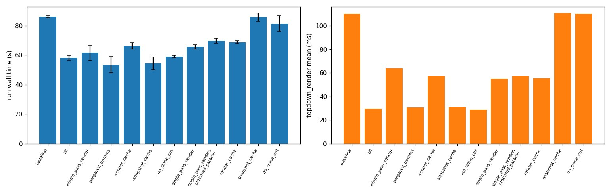

# Switchable top-down render optimisations: benchmark of each one

Date: 2026-10-26 (code state of that day); benchmark rerun on 2026-10-27 on an idle machine, replacing a first version of this log whose runs shared the machine with other jobs (their timings were not comparable and were dropped).

## Question
Each optimisation of the top-down map render (`src/utils/optimisations.py`) is switchable with `ACTIVESPLAT_OPTIMISATIONS`. How much does each one save on its own and in combination, and does any of them change the result?

## The optimisations
All concern the visualizer's top-down map renders (free map and visible map used by the planner, rendered from the Gaussian map with the 3DGS rasterizer once per mapper update and again for queries), and the visible-map snapshot. The baseline is the code before commit ac46440.

| Switch | What it changes | Where |
|---|---|---|
| `single_pass_render` | The rasterizer's `render()` runs two passes, an image pass and a silhouette/depth pass. The map renders only use the image, so only that pass runs (`with_depth_sil=False`; `render_o3d_image(fast=...)`). Also used at the mapper's other `get_rendervars` call sites. | `src/mapper/splatam/__init__.py` |
| `prepared_params` | The camera-independent derived tensors (activated colours, normalised rotations, scales) are computed once per map snapshot (`prepare_render_params`) and shared by the free and visible renders (and the saved high-resolution render), not recomputed in each. Needs `single_pass_render`. | `visualizer.py` (render block), `splatam` `get_rendervars(prepared=...)` |
| `render_cache` | A top-down render is reused while its inputs are unchanged: the free map is keyed by (mapper version, height cut, camera), the visible map by (snapshot key, camera), the saved image likewise. Without it every pass re-renders. | `visualizer.py` (render block) |
| `snapshot_cache` | The "visible map" snapshot (a height-cut copy of the live map) is taken only when the map version or the height sliders changed, not on every pass of the main loop. | `visualizer.py` (~line 1854) |
| `no_clone_cut` | The height cut no longer clones every parameter tensor first: the boolean-mask indexing already copies. | `visualizer.py` (`__params_to_cut`) |

`ACTIVESPLAT_VERIFY_TOPDOWN=1` re-renders every map the original way and compares bitwise (used when the render path is touched; it was not on in these runs).

## Setup
- Scene `gZ6f7yhEvPG` (Matterport3D), `config/datasets/mp3d_high_resolution.json` (512² sensor, 10 mapping iterations), 150 steps, native planner, depth seeding, no pose noise, image eval at the end of each run.
- 12 configurations x 2 repeats = 24 runs, strictly one at a time on GPU 0 (idle L40S, all four GPUs empty at the start), interleaved (repeat 1 of all configs, then repeat 2) so slow load drift spreads over them. 32-core machine, load average 1.3 at the start and 1.3–3.8 during (it includes the benchmark's own run).
- Launch: `GPU=0 bash scripts/tools/benchmark_optimisations.sh <manifest.tsv> 150 2`; summary: `python scripts/tools/benchmark_summary.py <manifest.tsv> --out_dir experiments/2026-10-26_optimisation_toggles`.
- Configurations: `baseline`; `all`; each one removed from all (`-name`); each one alone (`name`), plus `single_pass_render,prepared_params` since `prepared_params` needs the former.
- Wall time = first to last row of `timing.csv` (the mapping loop, without startup and the end-of-run evaluation).

## Metadata
Code at `c7c3954` plus the switches' state of `118d3f3` (no change in the render path since); see `runs.json` (git version, config and optimisations per run) and `manifest.tsv` (order, repeat, spec, load average at start and end, run directory). Run directories are `results/2026-10-27_09-50-20_…` onwards, listed in `manifest.tsv`. Raw per-stage numbers: `benchmark.csv`.

## Results
Mean over the 2 repeats (wall time with min–max), per-stage mean ms per call.

| Optimisations (spec) | Wall s (mean, range) | vs baseline | topdown_render ms | visibility_global ms | visibility_local ms | mapper ms | optimise ms | capture ms (control) | load at start | first 140 actions = baseline | traj. / novel PSNR |
|---|---|---|---|---|---|---|---|---|---|---|---|
| baseline | 86 (85-87) | 1.00x | 110.3 | 2117.0 | 110.2 | 165.1 | 106.5 | 9.9 | 2.0 | yes | 24.9 / 13.9 |
| all | 58 (56-60) | 1.48x | 29.6 | 1371.5 | 55.7 | 154.5 | 103.7 | 10.0 | 2.7 | yes | 24.9 / 13.9 |
| -single_pass_render | 62 (56-67) | 1.40x | 64.1 | 2121.2 | 104.1 | 147.3 | 97.0 | 8.7 | 3.2 | yes | 25.0 / 14.0 |
| -prepared_params | 53 (48-59) | 1.61x | 30.9 | 1353.5 | 54.0 | 147.6 | 99.8 | 8.8 | 3.3 | yes | 24.9 / 13.9 |
| -render_cache | 66 (64-68) | 1.30x | 57.6 | 1359.2 | 55.1 | 156.1 | 104.3 | 10.4 | 2.9 | yes | 25.0 / 14.0 |
| -snapshot_cache | 55 (50-59) | 1.58x | 31.4 | 1400.3 | 54.7 | 148.0 | 100.6 | 9.2 | 2.5 | yes | 25.0 / 14.0 |
| -no_clone_cut | 59 (58-60) | 1.46x | 29.0 | 1405.4 | 55.1 | 155.5 | 104.7 | 10.5 | 2.1 | yes | 25.0 / 14.0 |
| single_pass_render | 66 (64-67) | 1.31x | 55.1 | 1377.4 | 56.0 | 155.3 | 104.6 | 10.1 | 2.1 | yes | 25.0 / 14.0 |
| single_pass_render,prepared_params | 70 (68-71) | 1.23x | 57.5 | 1378.1 | 55.5 | 162.6 | 110.1 | 10.2 | 2.2 | yes | 24.9 / 13.9 |
| render_cache | 69 (68-70) | 1.25x | 55.4 | 2190.1 | 109.6 | 160.7 | 104.8 | 10.0 | 2.2 | yes | 25.0 / 14.0 |
| snapshot_cache | 86 (83-89) | 1.00x | 110.9 | 2170.7 | 108.6 | 161.6 | 104.4 | 9.9 | 2.6 | yes | 24.9 / 13.9 |
| no_clone_cut | 81 (76-87) | 1.06x | 110.2 | 2150.9 | 108.8 | 155.8 | 101.6 | 9.6 | 3.0 | yes | 25.0 / 14.0 |

Control stages: `capture`, `mapper` and `optimise` are not touched by any switch and are now flat across configurations (capture 8.7–10.5 ms; mapper 147–165 ms; optimise 97–110 ms), unlike in the first (invalid) attempt, so the machine load was comparable between runs. The last column is the first 140 actions matching the baseline's: all 24 runs agree for the first 143 actions, and in 8 of 24 runs (including repeats of the same configuration, e.g. `all` once yes, once no) the last 7 actions differ. That is native-planner nondeterminism, not an effect of any switch; trajectory PSNR is 24.9–25.0 and novel PSNR 13.9–14.0 everywhere.

## Reading
- Everything together (`all`): 86 s to 58 s, 1.48x; top-down render 110 to 30 ms; `visibility_global` 2117 to 1372 ms.
- `single_pass_render` is the largest single saving: alone it gives 1.31x and takes `visibility_global` from 2.1 s to 1.4 s (it is the only switch that does) and the render from 110 to 55 ms; removing it from `all` loses the most together with `render_cache`.
- `render_cache` roughly halves the render alone (110 to 55 ms, 1.25x); removing it from `all` costs 8 s (58 to 66 s). It adds to `single_pass_render` (55 to 30 ms together).
- `prepared_params` shows no measurable benefit: `single_pass_render,prepared_params` (70 s) is no faster than `single_pass_render` alone (66 s), and `all` without it (53 s, range 48–59) is not slower than `all` (58 s, range 56–60). The ranges overlap, so it is at best a small effect; it could be a candidate for removal.
- `snapshot_cache` and `no_clone_cut` alone are within noise of the baseline (86 vs 86 and 81 s; removing them from `all` changes 58 to 55 and 59 s). They are cheap and harmless but not worth much on this scene.
- Limits: 2 repeats, one scene, 150 steps, so differences of a few seconds (the spread is up to ~10 s for some configurations) are not resolved. Savings that scale with map size (more Gaussians in longer runs, bigger scenes) may be larger than here; 1000-step runs on the castle would show it.
