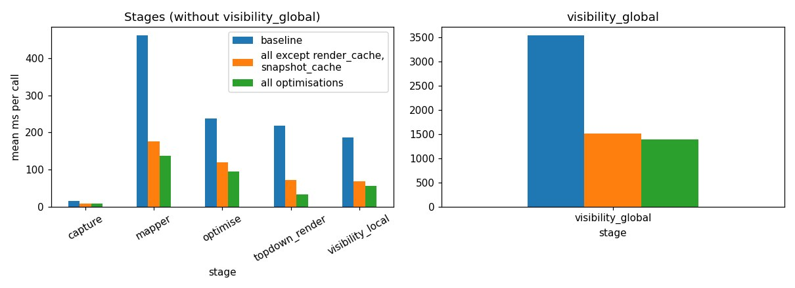

# Switchable top-down render optimisations: baseline vs all vs all-except-caches

Date: 2026-10-26. Runs reused from that day (nothing was run for this log).

## Question
Each optimisation of the top-down map render (`src/utils/optimisations.py`: `single_pass_render`, `prepared_params`, `render_cache`, `snapshot_cache`, `no_clone_cut`) is now switchable with `ACTIVESPLAT_OPTIMISATIONS`. Do they speed the run up, and do they leave the result unchanged?

## Setup
- Scene `gZ6f7yhEvPG` (Matterport3D), 150 steps, 512² sensor (`config/env/activesplat_high_resolution_pointnav.yaml`; dataset config presumably `config/datasets/mp3d_high_resolution.json`, not recorded in the run), native planner, depth seeding, no pose noise, image eval at the end of the run.
- Three runs, one per GPU, launched headless with `normal_run.sh` (roslaunch `habitat.launch`, `step_num:=150`, hide windows, own ROS master):
  - baseline: `ACTIVESPLAT_OPTIMISATIONS=baseline`
  - partial: `ACTIVESPLAT_OPTIMISATIONS=-render_cache,-snapshot_cache`
  - all: unset
- Not run here: the other single toggles (each on its own, or each removed from "all"); `single_pass_render` and `prepared_params` are only measured together with the rest.

## Metadata
Generated by `scripts/tools/experiment_log.py` (detail in `runs.json`). The runs were made on the working tree of 118d3f3's parent plus the uncommitted switches that 118d3f3 then committed; the code matches 118d3f3 for these paths. Log written at `c7c3954`.

| Run | Scene | Steps | Sensor config | Optimisations | Pose noise | Run directory |
|---|---|---|---|---|---|---|
| baseline | gZ6f7yhEvPG | 150 | `config/env/activesplat_high_resolution_pointnav.yaml` | baseline | off | `results/2026-10-26_12-04-49_mp3d_gZ6f7yhEvPG` |
| partial | gZ6f7yhEvPG | 150 | same | all except render_cache, snapshot_cache | off | `results/2026-10-26_12-04-44_mp3d_gZ6f7yhEvPG` |
| all | gZ6f7yhEvPG | 150 | same | all optimisations | off | `results/2026-10-26_13-49-39_mp3d_gZ6f7yhEvPG` |

## Results
Mean time per call of each stage (`timing.csv`, ms) and run wall time (first to last timing row):

| Stage | baseline | all except caches | all |
|---|---|---|---|
| topdown_render | 219.0 | 72.3 | 33.1 |
| visibility_global | 3543.5 | 1510.9 | 1395.7 |
| visibility_local | 185.6 | 68.3 | 55.4 |
| mapper | 461.6 | 176.4 | 136.3 |
| optimise | 237.1 | 120.1 | 94.0 |
| capture | 14.7 | 7.9 | 7.9 |
| Run wall time | 161 s | 63 s | 49 s |
| Top-down renders (done / reused from cache) | 558 / 0 | 468 / 0 | 300 / 194 |

Image metrics are identical in the three runs (trajectory 25.0 dB PSNR, 0.86 SSIM, depth L1 0.9 cm; novel 14.0 dB, 0.62, 2.9 cm), and `actions.txt` is byte-identical between the baseline and each other run.

## Reading
- The optimisations do not change the result: same actions and the same image metrics at 150 steps (within the ~250 steps where native-planner runs are reproducible; beyond that runs diverge, so this says nothing about 1000 steps).
- The render cache works: 194 of 494 requests were served from the cache with it on, none with it off, and the top-down render drops from 72 to 33 ms mean; the single-pass render and prepared parameters give 219 to 72 ms.
- **Do not read the other stage speed-ups as optimisation effects.** `capture`, `mapper` and `optimise` are not touched by these switches yet are also 1.2–1.9x faster, and the baseline's capture time (14.7 vs 7.9 ms) is almost twice the others. The baseline and partial runs shared the machine with each other and other jobs, and the "all" run ran next to another run later in the day, so machine load differs between the three. Only the top-down render, which the switches change directly, can be attributed; the wall times (161 / 63 / 49 s) mix real savings with load.
- For clean per-optimisation numbers: repeat on an idle machine, one run at a time, with each toggle on its own and each removed from "all", and several repeats per cell.

## Earlier related runs (not part of this log)
The 1000-step pair `results/2026-10-22_13-11-22_mp3d_gZ6f7yhEvPG` (optimised) and `…13-21-00_…` (baseline) predates the switches; the baseline there is the code before commit ac46440.
