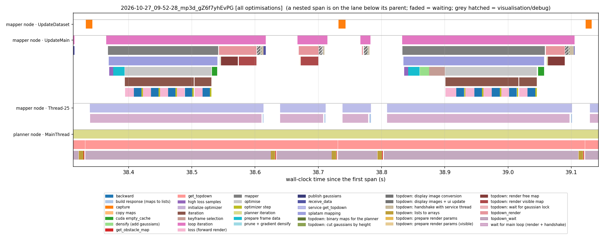
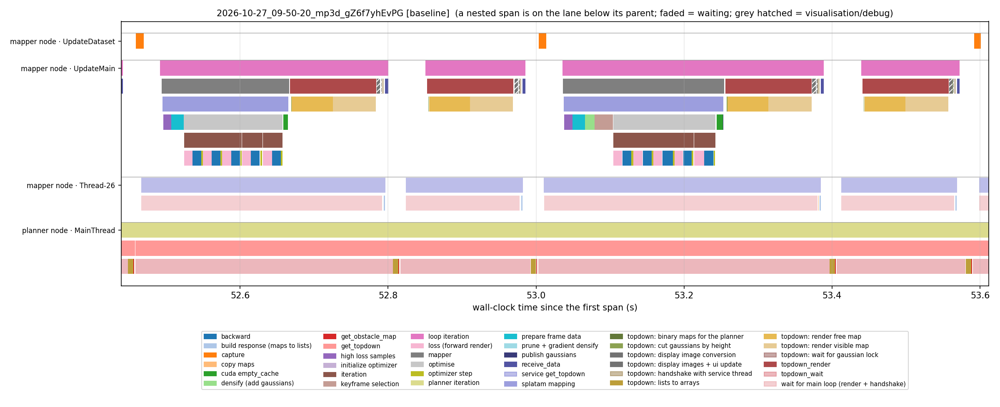
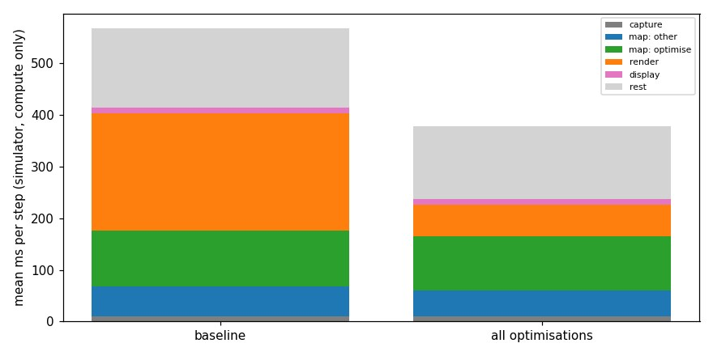
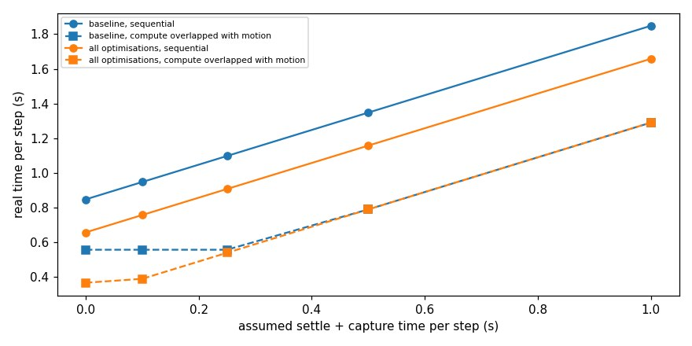

# Capture and settle time vs mapping time: where a step's time goes

Date: 2026-10-27. Reuses four runs of the optimisation benchmark (`experiments/2026-10-26_optimisation_toggles`); nothing new was run.

## Observation and question
For a real drone, each step is stop, settle, capture, then wait for the computer, then move. The concern: settling and capturing may dominate, so speeding up the mapping (the optimisations) hardly changes how fast or smooth a real trajectory is. What does one capture, map, plan step consist of, where is the time, and what runs in parallel?

**Not measured:** the settle/capture time of a real drone and its speeds. Everything below that involves them uses assumed values (forward 0.5 m/s, turn 60 deg/s, tilt 30 deg/s; the dashboard's real-time video defaults) and a sweep of the settle time. The only measured time called "capture" in the traces is the simulator's render of the sensor frame (about 10 ms), which is not the real settle time.

## Setup and metadata
- Runs (gZ6f7yhEvPG, `mp3d_high_resolution.json`, 512² sensor, 150 steps, native planner, no pose noise; benchmark runs executed one at a time on an idle GPU): `baseline` = `results/2026-10-27_09-50-20_mp3d_gZ6f7yhEvPG` and `results/2026-10-27_10-12-22_mp3d_gZ6f7yhEvPG`; `all optimisations` = `results/2026-10-27_09-52-28_mp3d_gZ6f7yhEvPG` and `results/2026-10-27_10-14-33_mp3d_gZ6f7yhEvPG`. The first 10 steps of each are dropped, repeats pooled.
- Git: `c7c3954`/`e4cfc17` (see `runs.json`). Analysis: `python scripts/tools/step_breakdown.py "baseline=<run>" ... "all optimisations=<run>" ... --out_dir experiments/2026-10-27_capture_settle_vs_compute`; timelines with `scripts/tools/timeline.py <run> --from_s --to_s`.
- A step is the interval between two consecutive `capture` spans; the spans that start inside it are summed per phase. Simulator motion is instantaneous (a teleport), so the step time here is pure compute.

## What one step contains
Timeline of two steps (about 0.8 s) of the optimised run, rows are threads (colours as in the legend; faded = waiting, hatched = visualisation only):

Baseline, same two steps:

The pipeline is **strictly sequential, in lock-step**; the only overlap is threads that wait for each other:
1. `UpdateDataset` thread: `capture` (about 10 ms, the simulator renders the frame and applies the previous command).
2. `UpdateMain` thread: `mapper` (frame preparation, high-loss samples, keyframe selection and densification on some steps, then the Gaussian optimisation: 5 mapping iterations of forward render, backward and optimiser step; roughly 100 ms), then `cuda empty_cache`, then the top-down renders for the planner (free and visible map), the display image conversion (visualisation only, about 11 ms) and a handshake with the service thread.
3. Mapper service thread (`Thread-25`) and planner `MainThread`: the planner's `get_topdown` request waits for the main loop to deliver the rendered maps (the faded `topdown_wait` / `wait for main loop` spans), then converts lists to arrays (about 7 ms), builds the obstacle map and plans (`planner_timing.csv`: plan_topdown about 12 ms, plan_logic about 4 ms per call; occasionally the global visibility computation, about 1.4 s, a few times per run).
4. The planner publishes the next command; the dataset thread's next `capture` follows.

So the mapper, the render and the planner never work on the same step at the same time: while one is running the others are blocked on it. The mapper does not run while the drone moves, and the drone does not move while the mapper runs. The only things running in parallel are the second thread's waiting and the Open3D/ROS plumbing. The mapper's optimisation (about 100 ms) and the map render (about 60–230 ms) are the large parts; a large remainder (about 140 ms) is thread handshakes, message passing, the planner and a second render triggered by the planner's request.

## Breakdown of a step (simulator, compute only)
| Phase (ms per step) | baseline mean (median) | all optimisations mean (median) |
|---|---|---|
| capture (simulator render of the sensor frame) | 10 (10) | 10 (10) |
| mapper: frame prep, keyframes, densify | 59 (45) | 51 (38) |
| mapper: Gaussian optimisation | 107 (114) | 104 (115) |
| top-down map render for the planner | 227 (232) | 62 (62) |
| display image conversion (visualisation only) | 11 (11) | 11 (11) |
| rest: handshakes between threads, ROS messages, planning, waiting, the occasional visibility computation | 154 (122) | 140 (120) |
| whole step (capture to next capture) | 568 (537) | 378 (361) |

- The optimisations take the step from 568 to 378 ms, almost entirely by cutting the top-down render (227 to 62 ms); the optimisation phase of the mapper (about 105 ms) is unchanged by them.
- "display image conversion" is visualisation only (it produces the images for the windows and saved panels) but sits on the critical path (about 11 ms per step), also in headless runs. It is a candidate for moving off the critical path or disabling.
- The "rest" of about 140 ms is the largest unexplained block and not yet broken down (handshakes, planner, a second render requested by the planner's `get_topdown`).

## Real-time model
Motion per step from the run's actions {1: 4, 2: 36, 3: 54, 4: 28, 5: 28} (1 forward 0.065 m, 2/3 turn 10.0 deg, 4/5 tilt 15.0 deg) at 0.5 m/s, 60.0 deg/s, 30.0 deg/s: mean 0.290 s per step.
| Settle + capture (s) | baseline: sequential s/step | all optimisations: sequential s/step | baseline: overlapped s/step | all optimisations: overlapped s/step | saving of all optimisations vs baseline: sequential | overlapped |
|---|---|---|---|---|---|---|
| 0 | 0.85 | 0.66 | 0.56 | 0.37 | 22 % | 34 % |
| 0.1 | 0.95 | 0.76 | 0.56 | 0.39 | 20 % | 30 % |
| 0.25 | 1.10 | 0.91 | 0.56 | 0.54 | 17 % | 3 % |
| 0.5 | 1.35 | 1.16 | 0.79 | 0.79 | 14 % | 0 % |
| 1 | 1.85 | 1.66 | 1.29 | 1.29 | 10 % | 0 % |

Compute per step (s, capture span excluded): baseline 0.558, all optimisations 0.368

Model: **sequential** = settle and capture + motion + compute (the drone hovers while the computer works, as in the dashboard's real-time video); **overlapped** = best case where the computer maps and plans while the drone settles and moves, so a step takes the larger of the two (this needs the planner to act on a map that is one step stale, which the current code does not do).

The steps are small here (6.5 cm forward, 10 deg turn, 15 deg tilt), so most of a step's time is overhead and a mean motion of 0.29 s is the same order as the compute. Fractions of a sequential step at 0.5 s settle: baseline 1.35 s = 37 % settle, 21 % motion, 41 % compute; optimised 1.16 s = 43 %, 25 %, 32 %.

## Reading
- Partly right: with an assumed 0.5 s settle, compute is still the largest part of a baseline step (41 %); after optimisation settle becomes the largest (43 % against 32 %). Settle exceeds the optimised compute (0.37 s per step) when it is longer than about 0.37 s. Faster mapping still matters in the sequential model (14 % at 0.5 s settle, 10 % at 1 s), but its relative value falls as settle grows.
- If the compute were overlapped with settling and motion, the optimisations would no longer matter once settle plus motion exceed the compute (0.37 s optimised, 0.56 s baseline): at 0.5 s settle both configurations take 0.79 s per step. The saving would only show for fast hardware (settle below about 0.1 s). In that regime the lever is the architecture (pipelining; acting on a one-step-stale map), not further speed-ups of the render.
- A camera that captures while moving removes the settle term but not the compute, so the optimised step would be dominated by motion plus compute (about 0.66 s here); and it adds motion blur, not tested.
- These are model results on assumed numbers. The experiment that would settle it is measuring the real settle time (and the achievable speed) of the target drone or a stand-in. The step structure and the compute numbers (one scene, 150 steps, 512 px sensor) are measured; occasional planning steps with the global visibility (1.4 s) are included in the mean but not the median.
