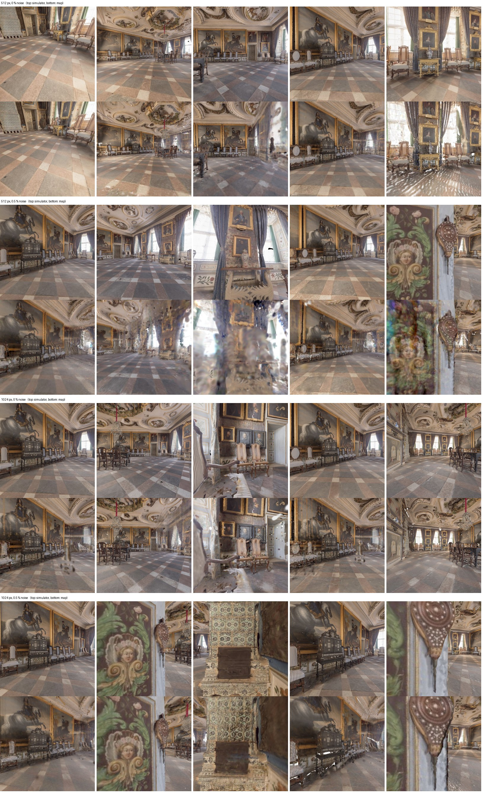

# Castle: simulated odometry drift (0 / 0.5 %) at 512 px and 1024 px sensors

Date: 2026-10-26/27. Status: complete. The first clean 512 px run crashed in the planner at step 92; it was rerun (2026-10-27, with the planner fix) and finished.

## Question
How much does 0.5 % simulated odometry drift (`pose_noise`, see `src/utils/pose_noise.py`) cost in image quality of the final Gaussian map on a large scene (skokloster-castle), and does the 1024 px sensor change that?

## Setup
- Scene `skokloster-castle`, 1000 steps, native planner, depth seeding, seed 0, GPU L40S (one run per GPU, GPUs 0 and 1).
- 512 px: `config/datasets/gibson_high_resolution.json` (512² sensor, 10 mapping iterations). 1024 px: `config/datasets/gibson_1024.json` (1024² sensor, same otherwise).
- Noise: translation and rotation drift 0.5 % of distance / angle moved, no jitter, via `ACTIVESPLAT_POSE_NOISE='{"translation_drift": 0.005, "rotation_drift": 0.005}'`.
- All optimisations on. Image metrics are the in-run evaluation (`src/evaluation/image_eval.py`): the final map rendered at the captured poses (every 5th step) and at 100 novel poses within 1.5 m, against the simulator's view; with noise the map is compared at the true poses mapped through the rigid ATE alignment.
- Launch: `scratchpad` scripts `lane2.sh` / `normal_run.sh` (roslaunch with `hide_mapper_windows:=1 hide_planner_windows:=1 save_runtime_data:=1`, one ROS master per run, `CUDA_VISIBLE_DEVICES=N gpu_id:=0`).

## Metadata and results
Generated with `python scripts/tools/experiment_log.py ... --out_dir experiments/2026-10-27_castle_pose_noise_resolution` (full detail in `runs.json`). The three noisy/1024 px runs used commit 118d3f3 without the planner fix; the 512 px clean run used it with the fix (a one-line change in `scripts/nodes/planner_node.py`).

Git: `118d3f3` on `main`; uncommitted tracked files at the time: none relevant (the planner fix came after).

| Run | Scene | Steps | Sensor config | Optimisations | Pose noise | Run directory |
|---|---|---|---|---|---|---|
| 1024 px, 0 % | skokloster-castle | 1000 | `config/env/activesplat_1024_pointnav.yaml` | all | off | `results/2026-10-26_14-59-08_gibson_skokloster-castle` |
| 1024 px, 0.5 % | skokloster-castle | 1000 | `config/env/activesplat_1024_pointnav.yaml` | all | 0.5 % / 0.5 % (seed 0) | `results/2026-10-26_15-24-04_gibson_skokloster-castle` |
| 512 px, 0.5 % | skokloster-castle | 1000 | `config/env/activesplat_high_resolution_pointnav.yaml` | all | 0.5 % / 0.5 % (seed 0) | `results/2026-10-26_16-29-33_gibson_skokloster-castle` |
| 512 px, 0 % | skokloster-castle | 1000 | `config/env/activesplat_high_resolution_pointnav.yaml` | all | off | `results/2026-10-27_09-08-51_gibson_skokloster-castle` (first attempt crashed at step 92, planner `Unknown condition.`) |

| Run | Set | PSNR | SSIM | LPIPS | Depth L1 (m) | Coverage | ATE RMSE (cm) | Mean rot. err (deg) |
|---|---|---|---|---|---|---|---|---|
| 512 px, 0 % | trajectory (200 views) | 23.4 | 0.74 | 0.259 | 0.34 | 99.5 % | 0 | 0 |
| 512 px, 0 % | novel (100 views) | 21.1 | 0.67 | 0.314 | 0.33 | 98.6 % | 0 | 0 |
| 1024 px, 0 % | trajectory (198 views) | 23.4 | 0.80 | 0.245 | 0.43 | 100.0 % | 0 | 0 |
| 1024 px, 0 % | novel (100 views) | 22.0 | 0.75 | 0.293 | 0.42 | 99.6 % | 0 | 0 |
| 1024 px, 0.5 % | trajectory (201 views) | 20.3 | 0.56 | 0.371 | 0.35 | 100.0 % | 4.3 | 0.74 |
| 1024 px, 0.5 % | novel (100 views) | 19.9 | 0.55 | 0.399 | 0.30 | 99.7 % | 4.3 | 0.74 |
| 512 px, 0.5 % | trajectory (201 views) | 19.3 | 0.49 | 0.395 | 0.53 | 99.9 % | 5.2 | 1.09 |
| 512 px, 0.5 % | novel (100 views) | 18.6 | 0.46 | 0.427 | 0.49 | 99.1 % | 5.2 | 1.09 |

Final translation error of the drifting poses: 14 cm (1024 px run), 24 cm (512 px run).

## Figures

`panels.jpg`: per row a run; columns are the 2nd, 4th and 6th trajectory panels and the 3rd and 5th novel panels; top the simulator's view, bottom the map's render at the same pose (`scripts/tools/panel_sheet.py`). The runs took different paths, so columns show different places.

## Reading
- Resolution (clean runs): the same PSNR on the trajectory set (23.4 dB at both), but 1024 px is better in SSIM (0.80 vs 0.74), LPIPS (0.245 vs 0.259) and on novel views (22.0 vs 21.1 dB). The sensor adds some detail but the scene's own texture is the main limit.
- Drift: 0.5 % drift costs 3.1 dB PSNR and 0.24 SSIM at 1024 px, and 4.1 dB and 0.25 SSIM at 512 px (trajectory set). Novel views lose 2.1 dB (1024 px) and 2.5 dB (512 px). The noisy maps are smeared and doubled at edges; the 512 px noisy map looks speckled.
- Drift costs more than a doubling of resolution gains, so pose accuracy matters more than sensor resolution for map quality.
- Caveats: one seed per cell, and the runs followed different paths (native planner diverges), so the evaluated views differ. Depth L1 is not ordered like the colour metrics for this reason; don't read it as noise helping. A same-pose comparison (`drift_same_views.py`, equal resolutions only) and several seeds would tighten this.
- The planner fix did not fire in the rerun (no re-planning warning in its log), so it is untested against the original crash; it only removes the exception.
